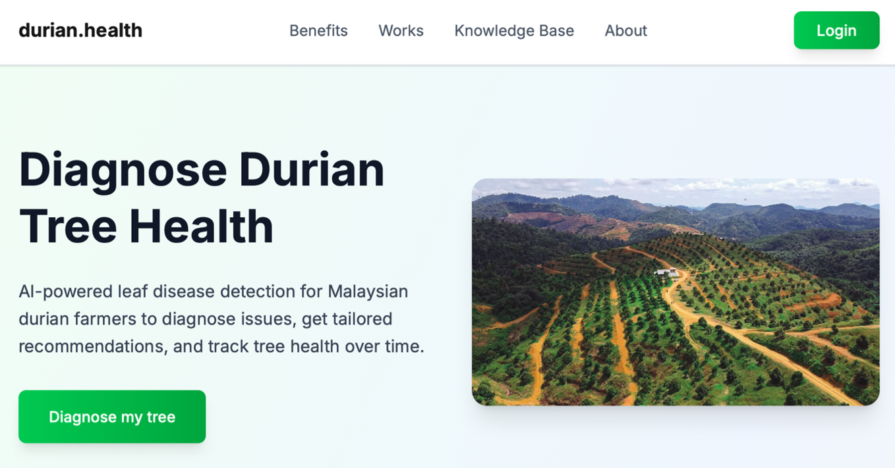

# durian.health 

An AI-powered web application for managing durian farms and detecting diseases using computer vision. This system helps farmers track the health of their trees, collaborate with team members, and diagnose issues early through image scanning.



## Key Features

-   **AI Disease Detection**: Upload or capture photos of durian leaves to detect diseases (e.g., Leaf Spot, Algal Leaf Spot) with high confidence.
-   **Farm Management**: Create digital twins of your farms, tracking location, total trees, and health statistics.
-   **Tree Tracking**: Individual profiles for every tree (`Tree ID`, `Cultivar`) with a full history of health scans.
-   **Team Collaboration**: Add members to your farm (Owners/Workers) to share access and management duties.
-   **Interactive Dashboard**: Visualize farm health trends, disease distribution, and recent activity at a glance.
-   **Secure Authentication**: Full user registration and login system protected by NextAuth.js.

## Tech Stack

-   **Framework**: [Next.js 15](https://nextjs.org/) (App Router)
-   **Language**: [TypeScript](https://www.typescriptlang.org/)
-   **Styling**: [Tailwind CSS](https://tailwindcss.com/)
-   **Database**: [MongoDB](https://www.mongodb.com/) (Mongoose ODM)
-   **Authentication**: [NextAuth.js](https://next-auth.js.org/)
-   **Icons**: [Lucide React](https://lucide.dev/)
-   **Animations**: [Framer Motion](https://www.framer.com/motion/)

## Getting Started

### Prerequisites

-   Node.js (v18 or higher)
-   npm / yarn / pnpm
-   MongoDB Database (Uri)

### Installation

1.  **Clone the repository**
    ```bash
    git clone https://github.com/XinYanggg/fyp-website.git
    cd fyp-website
    ```

2.  **Install dependencies**
    ```bash
    npm install
    ```

3.  **Configure Environment Variables**
    Create a `.env.local` file in the root directory and add the following:
    ```env
    # Database Connection
    MONGODB_URI=mongodb+srv://<username>:<password>@cluster.mongodb.net/yourdbname
    
    # NextAuth Configuration
    NEXTAUTH_URL=http://localhost:3000
    NEXTAUTH_SECRET=your-super-secret-key-here
    
    # Email Service
    SMTP_USER=your-email@gmail.com
    SMTP_PASS=your-app-password
    
    NEXT_APP_URL=http://localhost:3000
    
    # Google OAuth (create credentials in Google Cloud Console)
    GOOGLE_CLIENT_ID=your-client-id
    GOOGLE_CLIENT_SECRET=your-client-secret
    ```

4.  **Run the development server**
    ```bash
    npm run dev
    ```

5.  **Open the app**
    Visit [http://localhost:3000](http://localhost:3000) in your browser.

## Database Schema Reference

The application uses a flexible JSON-like schema for Farms and Trees. Below is an example structure:

```json
{
    "_id": "ObjectId",
    "ownerEmail": "owner@gmail.com",
    "name": "Durian Farm A",
    "location": "Pahang",
    "members": [
        { "email": "owner@gmail.com", "role": "owner" },
        { "email": "worker@gmail.com", "role": "member" }
    ],
    "trees": [
        {
            "id": "T001",
            "cultivar": "Musang King",
            "currentDisease": "Healthy",
            "confidence": 95,
            "lastScan": "1/2/2025, 3:33 PM",
            "scans": [
                {
                    "disease": "Healthy",
                    "confidence": 95,
                    "timestamp": "1/2/2025, 3:33 PM"
                }
            ]
        }
    ]
}
```

## API Security
All critical API routes (`/api/farm/*`, `/api/scan/*`) are protected and require a valid user session. The ML Model endpoint is proxied through `/api/scan/detect` to hide the external API key and URL.

## License
This project is for FYP purposes under Asia Pacific University

Student: FARN XIN YANG

Supervisor: DR. KULOTHUNKAN A/L PALASUNDRAM

Second Marker: ASSOC. PROF. DR. NIRASE FATHIMA ABUBACKER
